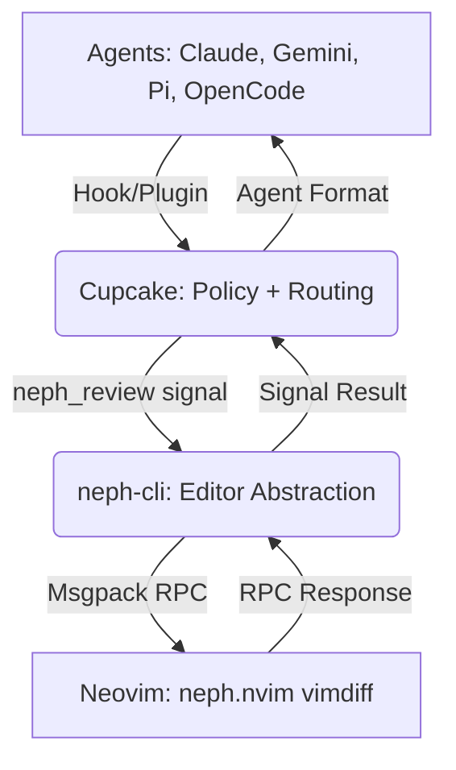
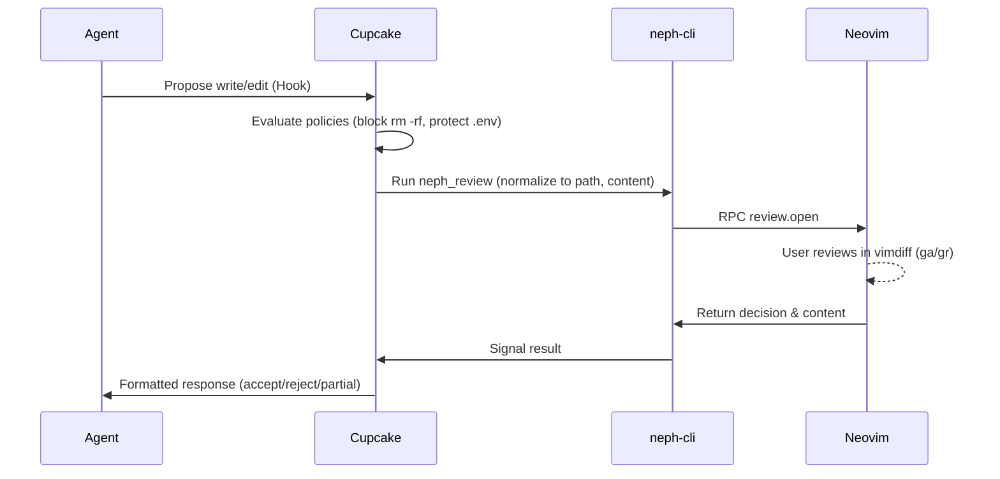

# Project Documentation

## Overview
Neph.nvim is a Neovim plugin for interactive code review using LLMs. It acts as an integration layer, providing terminal management, status bridging, and interactive diff reviews. It ensures agents do not interact with Neovim directly by using an intermediate policy and routing layer.

## Architecture

The system enforces a strict boundary where agents interact with the Cupcake policy layer, which invokes a CLI bridge to signal Neovim.

## Key Flows

### Interactive Review Flow

This flow triggers when an agent proposes file modifications.

## API Endpoints

The project uses a custom RPC protocol (`neph-rpc/v1`) between the `neph-cli` and Neovim over Unix sockets (`$NVIM`).

| Method | Description |
|--------|-------------|
| `review.open` | Opens an interactive vimdiff review. Returns `{ decision, content, hunks, reason }`. |
| `status.set` | Sets a `vim.g` global variable. |
| `status.get` | Gets a `vim.g` global variable. |
| `status.unset` | Unsets a `vim.g` global variable. |
| `buffers.check` | Calls `:checktime` to sync files. |
| `tab.close` | Closes the current tab. |
| `ui.notify` | Displays a notification. |
| `ui.select` | Shows a selection list to the user. |
| `ui.input` | Shows a text input prompt to the user. |
| `tools.status` | Returns a status table indicating tool availability and installation state for all agents. |
| `tools.install` | Installs tools for a specified agent. |
| `tools.install_all` | Installs tools for all agents. |
| `tools.uninstall` | Uninstalls tools for a specified agent. |
| `tools.preview` | Returns a formatted preview string showing what install would change for all agents. |
| `review.status` | Returns the status of the active review including tally of hunks (accepted, rejected, undecided). |
| `review.accept` | Accepts the undecided hunk at the given index or the next undecided hunk. |
| `review.reject` | Rejects the undecided hunk at the given index or the next undecided hunk, optionally with a reason. |
| `review.accept_all` | Accepts all remaining undecided hunks. |
| `review.reject_all` | Rejects all remaining undecided hunks, optionally with a reason. |
| `review.submit` | Finalizes the interactive review session. |
| `review.next` | Jumps to the next undecided hunk in the review. |

## Changelog
* [2026-06-22 16:22:48]: Updated API endpoints documentation to reflect new UI, tools, and review control methods.
* [2026-04-07 16:07:50]: Initial documentation created aggregating Architecture, Flows, and RPC API.
