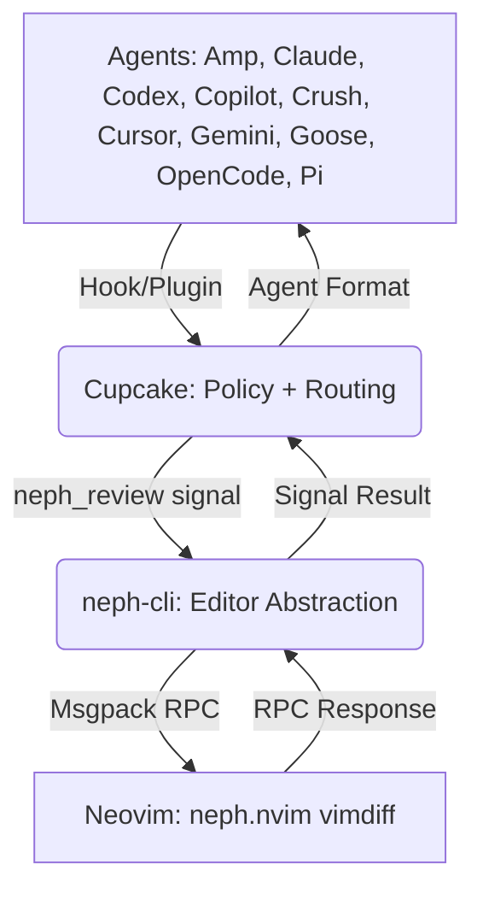
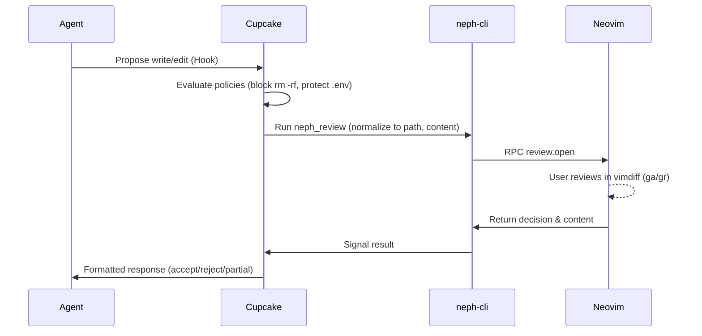

# Project Documentation

## Overview
Neph.nvim is a Neovim plugin for interactive code review using LLMs. It acts as an integration layer, providing terminal management, status bridging, and interactive diff reviews. It ensures agents do not interact with Neovim directly by using an intermediate policy and routing layer.

## Architecture

The system enforces a strict boundary where agents interact with the Cupcake policy layer, which invokes a CLI bridge to signal Neovim.

## Key Flows

### Interactive Review Flow

This flow triggers when an agent proposes file modifications.

## API Endpoints

The project uses a custom RPC protocol (`neph-rpc/v1`) between the `neph-cli` and Neovim over Unix sockets (`$NVIM`).

| Method | Description |
|--------|-------------|
| `review.open` | Opens an interactive vimdiff review. Returns `{ decision, content, hunks, reason }`. |
| `status.set` | Sets a `vim.g` global variable. |
| `status.unset` | Unsets a `vim.g` global variable. |
| `status.get` | Gets a `vim.g` global variable. |
| `buffers.check` | Calls `:checktime` to sync files. |
| `tab.close` | Closes the current tab. |
| `ui.select` | Shows a selection UI. |
| `ui.input` | Shows an input UI. |
| `ui.notify` | Shows a notification. |
| `tools.status` | Gets status of tools. |
| `tools.install` | Installs a tool. |
| `tools.install_all` | Installs all tools. |
| `tools.uninstall` | Uninstalls a tool. |
| `tools.preview` | Previews tools. |
| `review.status` | Gets review status. |
| `review.accept` | Accepts a review. |
| `review.reject` | Rejects a review. |
| `review.accept_all` | Accepts all reviews. |
| `review.reject_all` | Rejects all reviews. |
| `review.submit` | Submits a review. |
| `review.next` | Goes to next review. |

## Changelog
* [2026-05-19 16:05:58]: Updated Architecture diagram to include new agents (Amp, Codex, Copilot, Crush, Cursor, Goose). Updated API Endpoints table to align with protocol.json, removing `bus.register` and adding multiple `ui.*`, `tools.*`, and `review.*` methods.
* [2026-04-07 16:07:50]: Initial documentation created aggregating Architecture, Flows, and RPC API.
