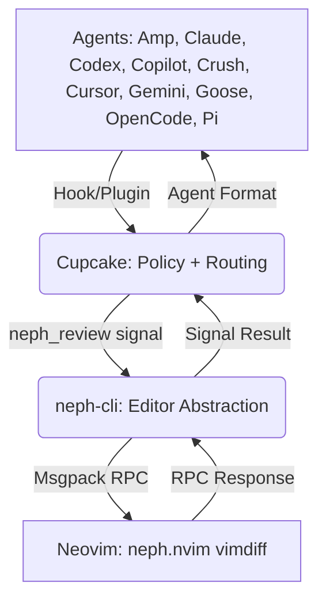
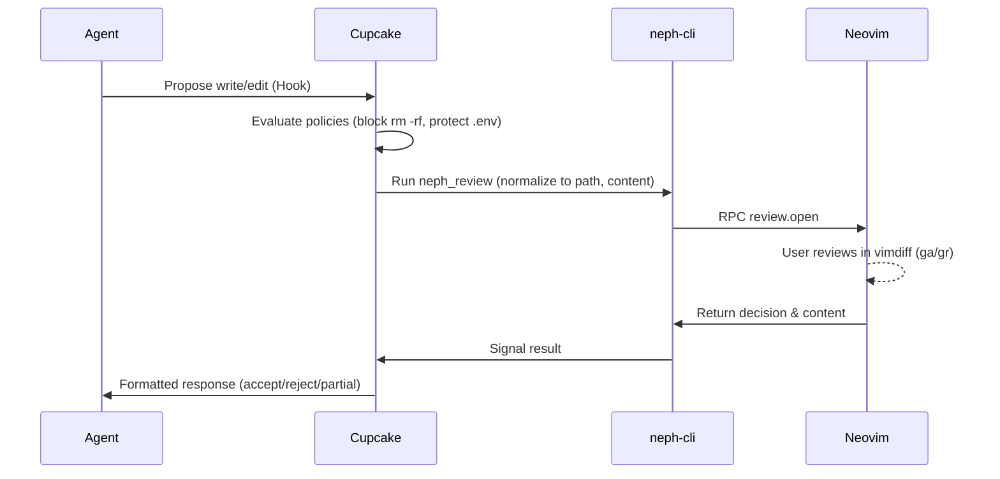

# Project Documentation

## Overview
Neph.nvim is a Neovim plugin for interactive code review using LLMs. It acts as an integration layer, providing terminal management, status bridging, and interactive diff reviews. It ensures agents do not interact with Neovim directly by using an intermediate policy and routing layer.

## Architecture

The system enforces a strict boundary where agents interact with the Cupcake policy layer, which invokes a CLI bridge to signal Neovim.

## Key Flows

### Interactive Review Flow

This flow triggers when an agent proposes file modifications.

## API Endpoints

The project uses a custom RPC protocol (`neph-rpc/v1`) between the `neph-cli` and Neovim over Unix sockets (`$NVIM`).

| Method | Description |
|--------|-------------|
| `buffers.check` | Calls `:checktime` to sync files. |
| `review.accept` | Accepts a hunk or file in the active review. Supports optional `idx` parameter. |
| `review.accept_all` | Accepts all changes in the active review. |
| `review.next` | Navigates to the next hunk or review item in the active review. |
| `review.open` | Opens an interactive vimdiff review. Returns `{ decision, content, hunks, reason }`. |
| `review.reject` | Rejects a hunk or file in the active review. Supports optional `idx` and `reason` parameters. |
| `review.reject_all` | Rejects all changes in the active review. Supports optional `reason` parameter. |
| `review.status` | Retrieves the status of the current active review. |
| `review.submit` | Submits the active review with the current decisions. |
| `status.get` | Gets a `vim.g` global variable. |
| `status.set` | Sets a `vim.g` global variable. |
| `status.unset` | Unsets a `vim.g` global variable. |
| `tab.close` | Closes the current tab. |
| `tools.install` | Installs a specific tool by name. |
| `tools.install_all` | Installs all configured tools. |
| `tools.preview` | Opens a preview window for tools. |
| `tools.status` | Retrieves the installation status of all tools. |
| `tools.uninstall` | Uninstalls a specific tool by name. |
| `ui.input` | Prompts the user for text input in the UI. |
| `ui.notify` | Sends a notification message to the Neovim UI. |
| `ui.select` | Prompts the user to select from a list of options in the UI. |

## Changelog
* [2026-06-11 16:28:43]: Updated Architecture agents list and API Endpoints to reflect current protocol.json.
* [2026-04-07 16:07:50]: Initial documentation created aggregating Architecture, Flows, and RPC API.
