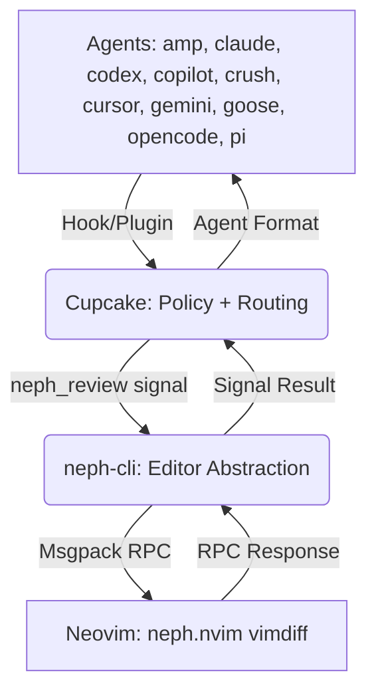
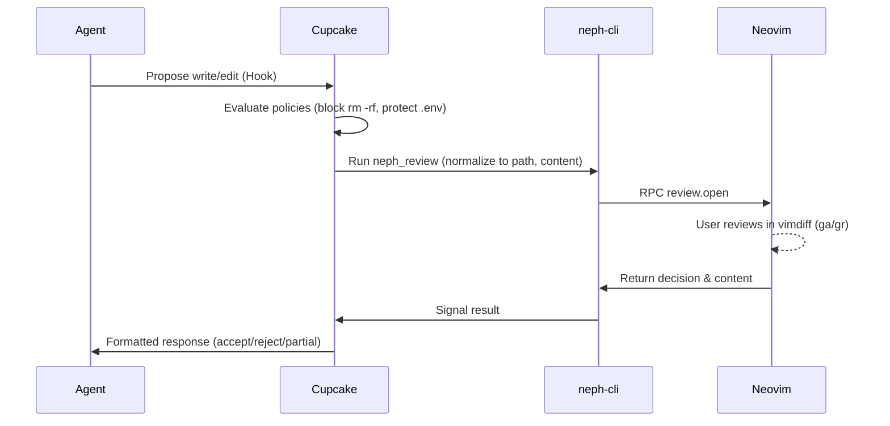

# Project Documentation

## Overview
Neph.nvim is a Neovim plugin for interactive code review using LLMs. It acts as an integration layer, providing terminal management, status bridging, and interactive diff reviews. It ensures agents do not interact with Neovim directly by using an intermediate policy and routing layer.

## Architecture

The system enforces a strict boundary where agents interact with the Cupcake policy layer, which invokes a CLI bridge to signal Neovim.

## Key Flows

### Interactive Review Flow

This flow triggers when an agent proposes file modifications.

## API Endpoints

The project uses a custom RPC protocol (`neph-rpc/v1`) between the `neph-cli` and Neovim over Unix sockets (`$NVIM`).

| Method | Description |
|--------|-------------|
| `review.open` | Opens an interactive vimdiff review. Returns `{ decision, content, hunks, reason }`. |
| `review.status` | Retrieves the status of the current review. |
| `review.accept` | Accepts a review hunk or file (optional `idx`). |
| `review.reject` | Rejects a review hunk or file (optional `idx`, `reason`). |
| `review.accept_all` | Accepts all review hunks or files. |
| `review.reject_all` | Rejects all review hunks or files (optional `reason`). |
| `review.submit` | Submits the current review. |
| `review.next` | Navigates to the next review item. |
| `status.set` | Sets a `vim.g` global variable. |
| `status.get` | Gets a `vim.g` global variable. |
| `status.unset` | Unsets a `vim.g` global variable. |
| `buffers.check` | Calls `:checktime` to sync files. |
| `tab.close` | Closes the current tab. |
| `ui.select` | Prompts the user to select from `options`. |
| `ui.input` | Prompts the user for input with a `default` value. |
| `ui.notify` | Sends a `message` notification with a specified `level`. |
| `tools.status` | Retrieves the status of tools. |
| `tools.install` | Installs a specified tool by `name`. |
| `tools.install_all`| Installs all available tools. |
| `tools.uninstall` | Uninstalls a specified tool by `name`. |
| `tools.preview` | Previews available tools. |

## Changelog
* [2026-04-07 16:07:50]: Initial documentation created aggregating Architecture, Flows, and RPC API.
* [2026-05-28 16:08:19]: Updated Architecture agents and API Endpoints to reflect codebase and protocol changes.
