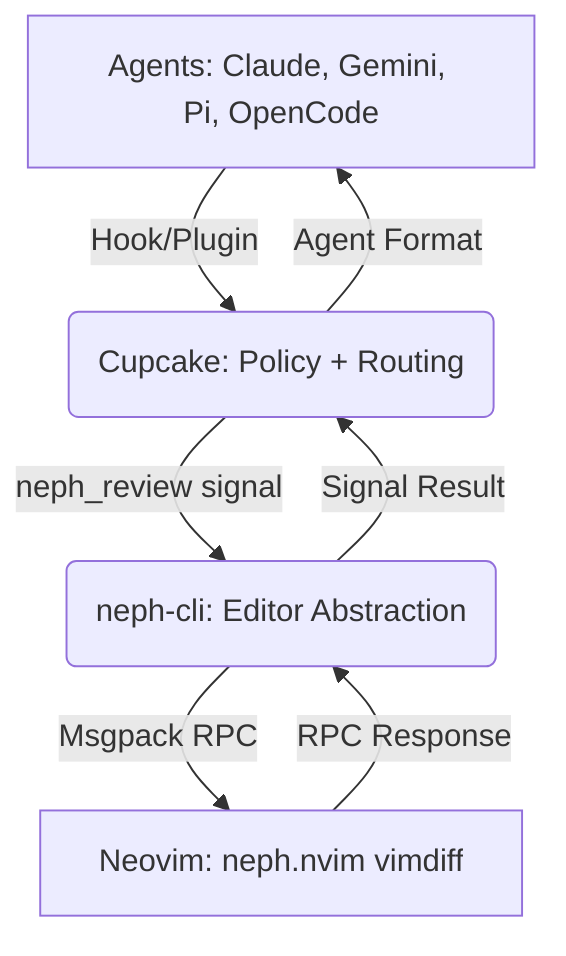
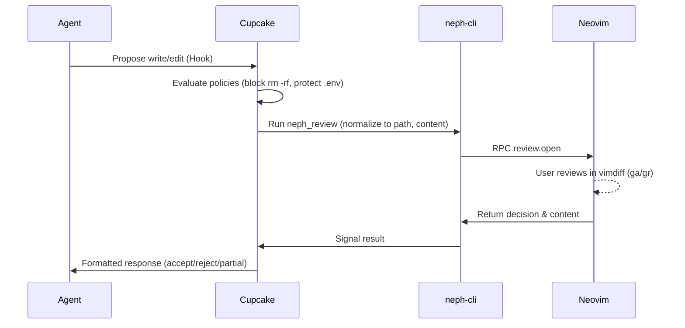

# Project Documentation

## Overview
Neph.nvim is a Neovim plugin for interactive code review using LLMs. It acts as an integration layer, providing terminal management, status bridging, and interactive diff reviews. It ensures agents do not interact with Neovim directly by using an intermediate policy and routing layer.

## Architecture

The system enforces a strict boundary where agents interact with the Cupcake policy layer, which invokes a CLI bridge to signal Neovim.

## Key Flows

### Interactive Review Flow

This flow triggers when an agent proposes file modifications.

## API Endpoints

The project uses a custom RPC protocol (`neph-rpc/v1`) between the `neph-cli` and Neovim over Unix sockets (`$NVIM`).

| Method | Description |
|--------|-------------|
| `buffers.check` | Calls `:checktime` to sync files. |
| `review.accept` | Accepts a review hunk by its index in the active review. |
| `review.accept_all` | Accepts all review hunks in the active review. |
| `review.next` | Navigates to the next undecided hunk in the active review. |
| `review.open` | Opens an interactive vimdiff review. Returns `{ decision, content, hunks, reason }`. |
| `review.reject` | Rejects a review hunk by its index in the active review, optionally providing a reason. |
| `review.reject_all` | Rejects all review hunks in the active review, optionally providing a reason. |
| `review.status` | Returns the status of the active review session. |
| `review.submit` | Submits the active review decisions. |
| `status.get` | Gets a `vim.g` global variable. |
| `status.set` | Sets a `vim.g` global variable. |
| `status.unset` | Unsets a `vim.g` global variable. |
| `tab.close` | Closes the current tab. |
| `tools.install` | Installs a specified tool agent. |
| `tools.install_all` | Installs all available tool agents. |
| `tools.preview` | Previews available tool agents. |
| `tools.status` | Retrieves the status of configured tool agents. |
| `tools.uninstall` | Uninstalls a specified tool agent. |
| `ui.input` | Prompts the user for input using `vim.ui.input`. |
| `ui.notify` | Sends a notification message using `vim.notify`. |
| `ui.select` | Prompts the user to select from options using `vim.ui.select`. |

## Changelog
* [2026-07-02 16:15:16]: Updated API Endpoints to reflect new `review.*`, `tools.*`, and `ui.*` methods, and removed deprecated `bus.register`.
* [2026-04-07 16:07:50]: Initial documentation created aggregating Architecture, Flows, and RPC API.
