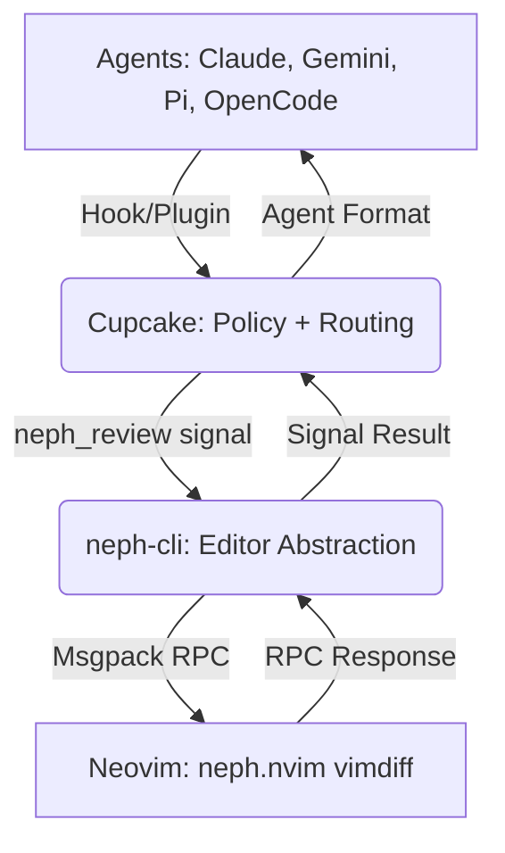
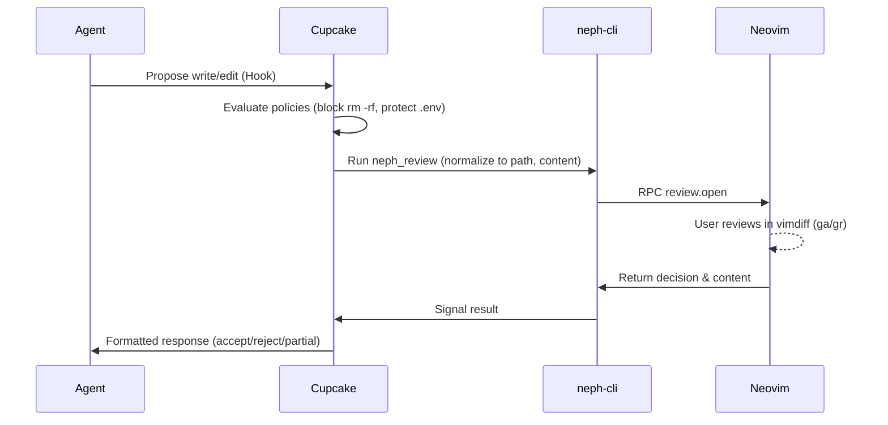

# Project Documentation

## Overview
Neph.nvim is a Neovim plugin for interactive code review using LLMs. It acts as an integration layer, providing terminal management, status bridging, and interactive diff reviews. It ensures agents do not interact with Neovim directly by using an intermediate policy and routing layer.

## Architecture

The system enforces a strict boundary where agents interact with the Cupcake policy layer, which invokes a CLI bridge to signal Neovim.

## Key Flows

### Interactive Review Flow

This flow triggers when an agent proposes file modifications.

## API Endpoints

The project uses a custom RPC protocol (`neph-rpc/v1`) between the `neph-cli` and Neovim over Unix sockets (`$NVIM`).

| Method | Description |
|--------|-------------|
| `review.open` | Opens an interactive vimdiff review. `params: ["request_id", "path", "content"]` |
| `review.status` | Returns the active review status and hunk tally. `params: []` |
| `review.accept` | Accepts a specific undecided hunk or the next one. `params: []` |
| `review.reject` | Rejects a specific undecided hunk or the next one. `params: []` |
| `review.accept_all` | Accepts all remaining undecided hunks. `params: []` |
| `review.reject_all` | Rejects all remaining undecided hunks. `params: []` |
| `review.submit` | Finalizes the active review. `params: []` |
| `review.next` | Jumps to the next undecided hunk. `params: []` |
| `status.set` | Sets a `vim.g` global variable. `params: ["name", "value"]` |
| `status.get` | Gets a `vim.g` global variable. `params: ["name"]` |
| `status.unset` | Unsets a `vim.g` global variable. `params: ["name"]` |
| `buffers.check` | Calls `:checktime` to sync files. `params: []` |
| `tab.close` | Closes the current tab. `params: []` |
| `ui.select` | Prompts the user with `vim.ui.select`. `params: ["request_id", "channel_id", "title", "options"]` |
| `ui.input` | Prompts the user with `vim.ui.input`. `params: ["request_id", "channel_id", "title", "default"]` |
| `ui.notify` | Notifies the user with `vim.notify`. `params: ["message", "level"]` |
| `tools.status` | Returns the installation status of tools for all agents. `params: []` |
| `tools.install` | Installs tools for a specific agent. `params: ["name"]` |
| `tools.install_all` | Installs tools for all agents. `params: []` |
| `tools.uninstall` | Uninstalls tools for a specific agent. `params: ["name"]` |
| `tools.preview` | Previews the tool configuration for all agents. `params: []` |

## Changelog
* [2026-06-16 16:37:51]: Updated API Endpoints section due to missing endpoints and removed outdated ones.
* [2026-04-07 16:07:50]: Initial documentation created aggregating Architecture, Flows, and RPC API.
