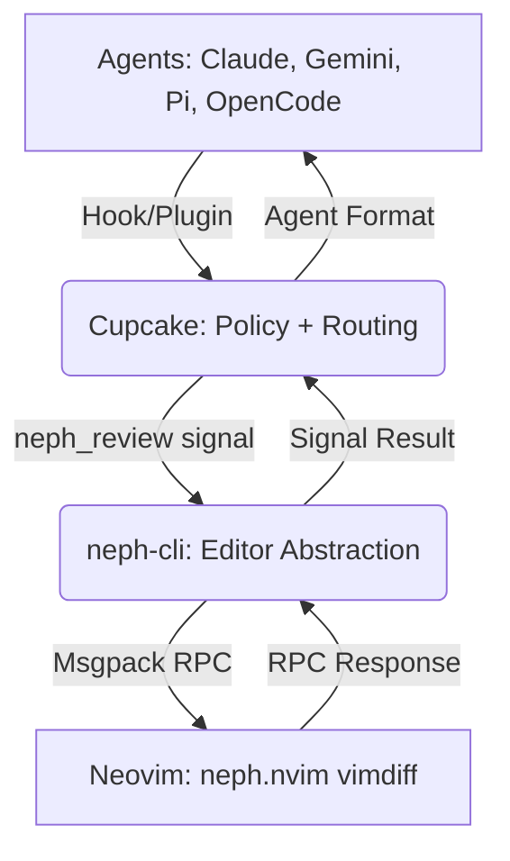
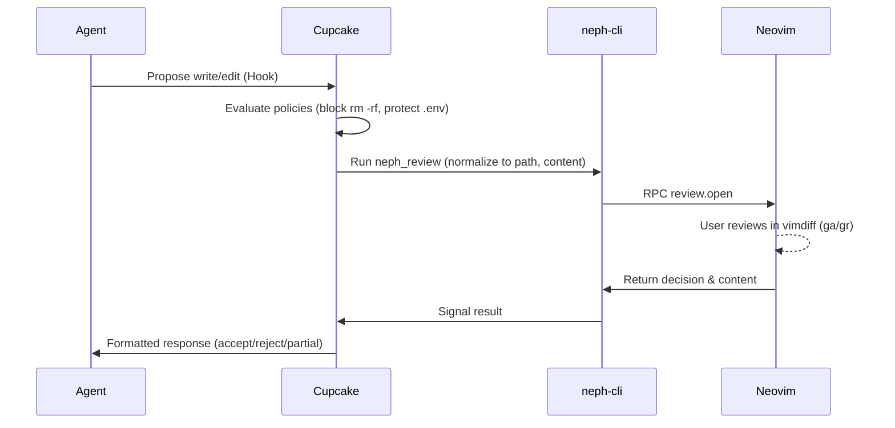

# Project Documentation

## Overview
Neph.nvim is a Neovim plugin for interactive code review using LLMs. It acts as an integration layer, providing terminal management, status bridging, and interactive diff reviews. It ensures agents do not interact with Neovim directly by using an intermediate policy and routing layer.

## Architecture

The system enforces a strict boundary where agents interact with the Cupcake policy layer, which invokes a CLI bridge to signal Neovim.

## Key Flows

### Interactive Review Flow

This flow triggers when an agent proposes file modifications.

## API Endpoints

The project uses a custom RPC protocol (`neph-rpc/v1`) between the `neph-cli` and Neovim over Unix sockets (`$NVIM`).

| Method | Description |
|--------|-------------|
| `buffers.check` | Calls `:checktime` to sync files. |
| `review.accept` | Accepts a specific hunk or the entire review. |
| `review.accept_all` | Accepts all hunks in the current review. |
| `review.next` | Jumps to the next undecided hunk in the review. |
| `review.open` | Opens an interactive vimdiff review. Returns `{ decision, content, hunks, reason }`. |
| `review.reject` | Rejects a specific hunk or the entire review. |
| `review.reject_all` | Rejects all hunks in the current review. |
| `review.status` | Returns the current status of the active review. |
| `review.submit` | Submits the active review, finalizing decisions. |
| `status.get` | Gets a `vim.g` global variable. |
| `status.set` | Sets a `vim.g` global variable. |
| `status.unset` | Unsets a `vim.g` global variable. |
| `tab.close` | Closes the current tab. |
| `tools.install` | Installs a specific tool via its name. |
| `tools.install_all` | Installs all available tools. |
| `tools.preview` | Returns a preview of the tool states or UI. |
| `tools.status` | Returns the status of all registered tools. |
| `tools.uninstall` | Uninstalls a specific tool. |
| `ui.input` | Displays a `vim.ui.input` prompt. |
| `ui.notify` | Displays a notification using `vim.notify`. |
| `ui.select` | Displays a `vim.ui.select` menu. |

## Changelog
* [2026-07-03 16:22:31]: Updated API Endpoints table to reflect current protocol.json definitions.
* [2026-04-07 16:07:50]: Initial documentation created aggregating Architecture, Flows, and RPC API.
