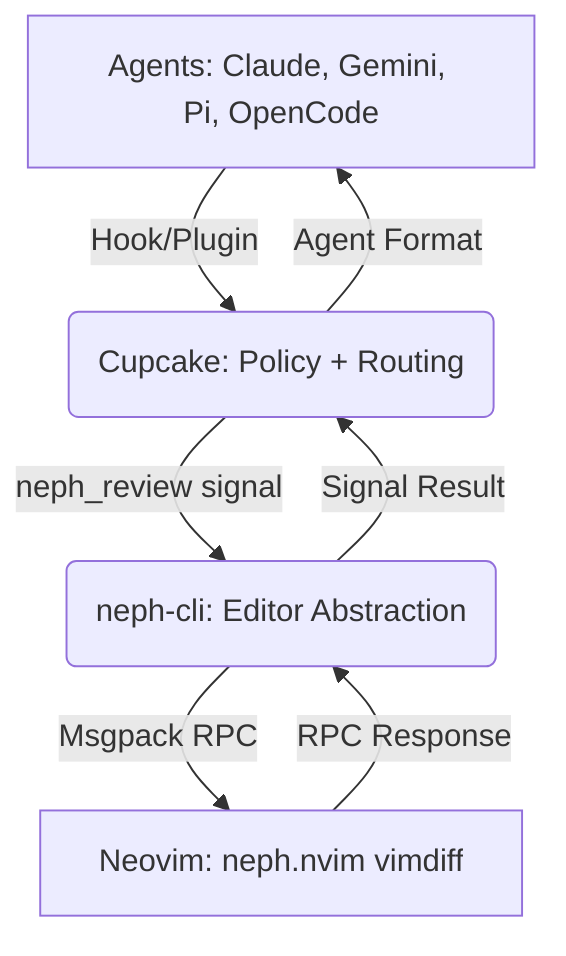
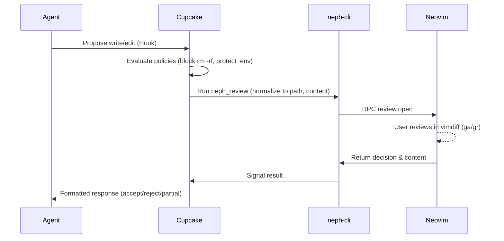

# Project Documentation

## Overview
Neph.nvim is a Neovim plugin for interactive code review using LLMs. It acts as an integration layer, providing terminal management, status bridging, and interactive diff reviews. It ensures agents do not interact with Neovim directly by using an intermediate policy and routing layer.

## Architecture

The system enforces a strict boundary where agents interact with the Cupcake policy layer, which invokes a CLI bridge to signal Neovim.

## Key Flows

### Interactive Review Flow

This flow triggers when an agent proposes file modifications.

## API Endpoints

The project uses a custom RPC protocol (`neph-rpc/v1`) between the `neph-cli` and Neovim over Unix sockets (`$NVIM`).

| Method | Description |
|--------|-------------|
| `review.open` | Opens an interactive vimdiff review. Returns `{ decision, content, hunks, reason }`. |
| `status.set` | Sets a `vim.g` global variable. |
| `status.get` | Gets a `vim.g` global variable. |
| `status.unset` | Unsets a `vim.g` global variable. |
| `buffers.check` | Calls `:checktime` to sync files. |
| `tab.close` | Closes the current tab. |
| `ui.select` | Shows a selection list (using `vim.ui.select`). |
| `ui.input` | Shows a text input prompt (using `vim.ui.input`). |
| `ui.notify` | Displays a notification (using `vim.notify`). |
| `tools.status` | Returns the installation status of all agent tools. |
| `tools.install` | Installs tools for a specific agent. |
| `tools.install_all` | Installs tools for all agents. |
| `tools.uninstall` | Uninstalls tools for a specific agent. |
| `tools.preview` | Previews tool installations. |
| `review.status` | Returns the status of the active review. |
| `review.accept` | Accepts a specific hunk or the next undecided hunk. |
| `review.reject` | Rejects a specific hunk or the next undecided hunk. |
| `review.accept_all` | Accepts all remaining undecided hunks. |
| `review.reject_all` | Rejects all remaining undecided hunks. |
| `review.submit` | Submits the final review decision. |
| `review.next` | Navigates to the next undecided hunk. |

## Changelog
* [2026-06-28 16:35:15]: Updated API Endpoints table to reflect added UI, Tools, and Review control RPC methods, and removed deprecated bus.register.
* [2026-04-07 16:07:50]: Initial documentation created aggregating Architecture, Flows, and RPC API.
