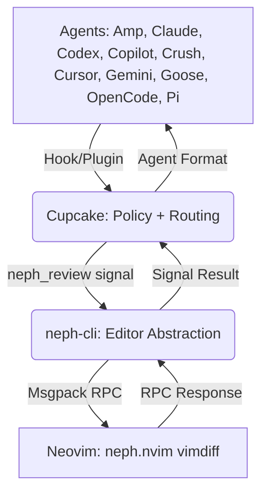
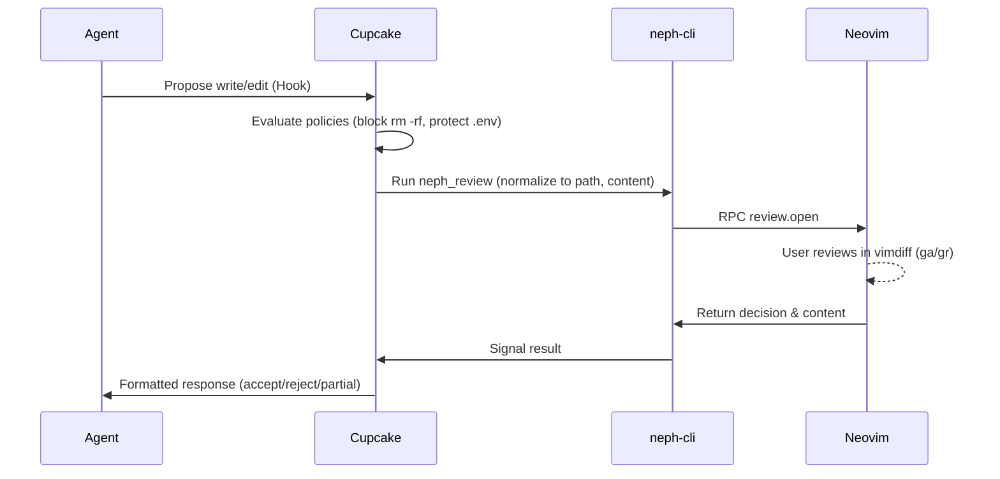

# Project Documentation

## Overview
Neph.nvim is a Neovim plugin for interactive code review using LLMs. It acts as an integration layer, providing terminal management, status bridging, and interactive diff reviews. It ensures agents do not interact with Neovim directly by using an intermediate policy and routing layer.

## Architecture

The system enforces a strict boundary where agents interact with the Cupcake policy layer, which invokes a CLI bridge to signal Neovim.

## Key Flows

### Interactive Review Flow

This flow triggers when an agent proposes file modifications.

## API Endpoints

The project uses a custom RPC protocol (`neph-rpc/v1`) between the `neph-cli` and Neovim over Unix sockets (`$NVIM`).

| Method | Description |
|--------|-------------|
| `buffers.check` | Calls `:checktime` to sync files. |
| `review.accept` | Accepts the current review. |
| `review.accept_all` | Accepts all hunks in the review. |
| `review.next` | Jumps to the next hunk in the review. |
| `review.open` | Opens an interactive vimdiff review. Returns `{ decision, content, hunks, reason }`. |
| `review.reject` | Rejects the current review. |
| `review.reject_all` | Rejects all hunks in the review. |
| `review.status` | Gets the status of the review. |
| `review.submit` | Submits the review. |
| `status.get` | Gets a `vim.g` global variable. |
| `status.set` | Sets a `vim.g` global variable. |
| `status.unset` | Unsets a `vim.g` global variable. |
| `tab.close` | Closes the current tab. |
| `tools.install` | Installs an agent integration. |
| `tools.install_all` | Installs all agent integrations. |
| `tools.preview` | Previews the tools. |
| `tools.status` | Gets the status of tools. |
| `tools.uninstall` | Uninstalls an agent integration. |
| `ui.input` | Opens a UI input. |
| `ui.notify` | Sends a UI notification. |
| `ui.select` | Opens a UI selection. |

## Changelog
* [2026-05-26 16:09:54]: Updated documentation to include new agents and expanded API endpoints.
* [2026-04-07 16:07:50]: Initial documentation created aggregating Architecture, Flows, and RPC API.
