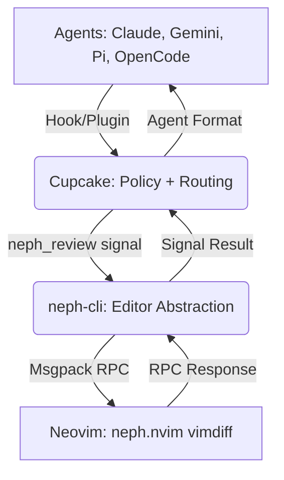
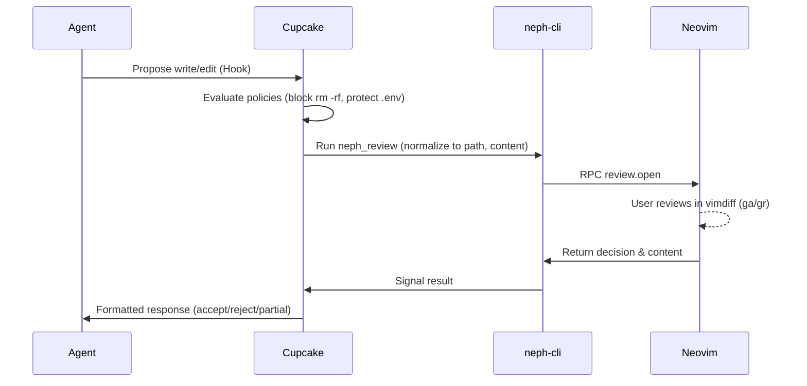

# Project Documentation

## Overview
Neph.nvim is a Neovim plugin for interactive code review using LLMs. It acts as an integration layer, providing terminal management, status bridging, and interactive diff reviews. It ensures agents do not interact with Neovim directly by using an intermediate policy and routing layer.

## Architecture

The system enforces a strict boundary where agents interact with the Cupcake policy layer, which invokes a CLI bridge to signal Neovim.

## Key Flows

### Interactive Review Flow

This flow triggers when an agent proposes file modifications.

## API Endpoints

The project uses a custom RPC protocol (`neph-rpc/v1`) between the `neph-cli` and Neovim over Unix sockets (`$NVIM`).

| Method | Description |
|--------|-------------|
| `buffers.check` | Calls `:checktime` to sync files. |
| `review.accept` | Accepts the specified hunk (or next undecided). Returns `{ ok, idx, next }`. |
| `review.accept_all` | Accepts all remaining undecided hunks. Returns `{ ok, count }`. |
| `review.next` | Jumps to the next undecided hunk. Returns `{ ok, idx }`. |
| `review.open` | Opens an interactive vimdiff review. Returns `{ decision, content, hunks, reason }`. |
| `review.reject` | Rejects the specified hunk (or next undecided). Returns `{ ok, idx, next }`. |
| `review.reject_all` | Rejects all remaining undecided hunks. Returns `{ ok, count }`. |
| `review.status` | Returns the active review status, file path, and hunk tally. |
| `review.submit` | Submits the completed review. |
| `status.get` | Gets a `vim.g` global variable. |
| `status.set` | Sets a `vim.g` global variable. |
| `status.unset` | Unsets a `vim.g` global variable. |
| `tab.close` | Closes the current tab. |
| `tools.install` | Installs dependencies for a specific agent. |
| `tools.install_all` | Installs dependencies for all agents. |
| `tools.preview` | Dry-run previews tool installations. |
| `tools.status` | Returns installation status for agent tools. |
| `tools.uninstall` | Uninstalls tools for a specific agent. |
| `ui.input` | Shows a text input prompt to the user. |
| `ui.notify` | Displays a notification message. |
| `ui.select` | Shows a selection list to the user. |

## Changelog
* [2026-06-26 16:11:08]: Updated API Endpoints table to reflect current protocol.json.
* [2026-04-07 16:07:50]: Initial documentation created aggregating Architecture, Flows, and RPC API.
